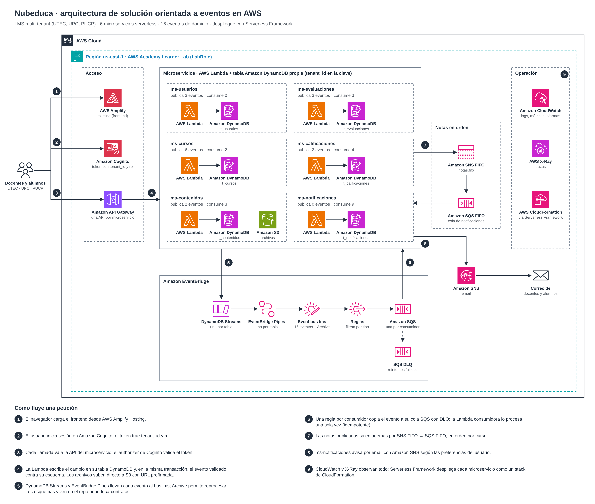

# Event storming del MVP

Este es el event storming ya armado para la sesión de ARQ-01: 6 flujos que usan los 16 eventos del catálogo. En la sesión el equipo lo valida o lo corrige. Lo que cambie se actualiza en `eventos/catalogo.yaml` y en `apis/`, y `scripts/validar_contratos.py` confirma que todo sigue cuadrando.

El diagrama usa los íconos oficiales de AWS; los pasos 4 a 8 son el recorrido de los eventos. Se edita en `docs/arquitectura-aws.drawio` (draw.io / app.diagrams.net).

Cada fila se lee así: un **actor** ejecuta un **comando** (una operación de la API), el comando produce un **evento** y el evento dispara **reacciones** en otros microservicios.

## 1. Alta de la institución y del usuario

| Actor | Comando | Evento | Reacción |
|---|---|---|---|
| Seed | `poblar_datos.py` crea utec, upc y pucp | `tenant.created` | Ninguna; queda en el Archive del bus |
| ADMIN | `POST /terms` y `POST /terms/{termId}/start` (ms-usuarios) | `term.started` | ms-cursos guarda el periodo como activo |
| Cualquier usuario | Login en Cognito y `POST /users/me` (ms-usuarios) | `user.provisioned` | ms-cursos guarda código institucional → userId; ms-notificaciones crea sus preferencias por defecto |

## 2. Curso y matrícula

| Actor | Comando | Evento | Reacción |
|---|---|---|---|
| TEACHER | `POST /courses` (ms-cursos) | `course.created` | ms-contenidos prepara el espacio de módulos del curso |
| TEACHER | `POST /courses/{courseId}/enrollments/import` con el CSV | `enrollment.created`, uno por alumno | ms-contenidos, ms-evaluaciones, ms-calificaciones y ms-notificaciones agregan al alumno a su lista del curso |
| TEACHER | `POST /courses/{courseId}/publish` | `course.published` | ms-notificaciones avisa a los matriculados |

## 3. Contenido

| Actor | Comando | Evento | Reacción |
|---|---|---|---|
| TEACHER | `POST /files` (ms-contenidos) y `PUT` del archivo a la URL de S3 | — | La Lambda de antivirus se dispara con el evento de S3 |
| Lambda de antivirus | Escanea el archivo | `file.scanned` | El archivo pasa a CLEAN o INFECTED |
| TEACHER | Crea el módulo, le agrega ítems y llama `POST .../modules/{moduleId}/publish` | `module.published` | ms-notificaciones avisa a los matriculados |

## 4. Tarea, entrega y nota (ruta crítica)

| Actor | Comando | Evento | Reacción |
|---|---|---|---|
| TEACHER | `POST /courses/{courseId}/assignments` y `POST /assignments/{assignmentId}/publish` (ms-evaluaciones) | `assignment.published` | ms-calificaciones crea la columna en el libro de notas; ms-notificaciones avisa |
| STUDENT | `POST /files` con purpose SUBMISSION y `PUT` a S3 | `file.scanned` | ms-evaluaciones marca el archivo como entregable |
| STUDENT | `POST /assignments/{assignmentId}/submissions` | `submission.submitted` | ms-notificaciones manda la constancia al alumno |
| TEACHER | `POST /submissions/{submissionId}/grade` | `submission.graded` | ms-calificaciones guarda la nota en DRAFT y emite `grade.changed` (GRADED), que la auditoría registra |
| TEACHER | `POST /grade-items/{gradeItemId}/post` (ms-calificaciones) | `grade.posted`, uno por alumno, al bus y a SNS FIFO | ms-notificaciones avisa a cada alumno, en orden por curso |
| TEACHER | `PATCH /grades/{gradeId}` con un motivo | `grade.changed` (MANUAL_OVERRIDE) y, si ya estaba publicada, `grade.posted` | La auditoría registra el cambio; ms-notificaciones avisa la nota nueva |

## 5. Anuncio

| Actor | Comando | Evento | Reacción |
|---|---|---|---|
| TEACHER | `POST /courses/{courseId}/announcements` (ms-cursos) | `announcement.published` | ms-notificaciones avisa a los matriculados que no lo desactivaron |

## 6. Retiro y cierre

| Actor | Comando | Evento | Reacción |
|---|---|---|---|
| TEACHER | `DELETE /courses/{courseId}/enrollments/{enrollmentId}` | `enrollment.dropped` | Los 4 consumidores le quitan el acceso al alumno |
| TEACHER | `POST /courses/{courseId}/archive` | `course.archived` | Ninguna en el MVP; queda en el Archive del bus |

## Lo que cada microservicio guarda de otros

Ningún microservicio lee la tabla de otro. Lo que necesita lo copia de los eventos (una proyección):

| Microservicio | Proyección | Se alimenta de |
|---|---|---|
| ms-cursos | Periodos activos; código institucional → userId | `term.started`, `user.provisioned` |
| ms-contenidos | Cursos existentes; matriculados por curso | `course.created`, `enrollment.*` |
| ms-evaluaciones | Matriculados por curso; estado de cada archivo | `enrollment.*`, `file.scanned` |
| ms-calificaciones | Columnas del libro; alumnos por curso; notas en DRAFT | `assignment.published`, `enrollment.*`, `submission.graded` |
| ms-notificaciones | Preferencias; matriculados por curso | `user.provisioned`, `enrollment.*` |

## Preguntas para la sesión

- [ ] La nota se pone en ms-evaluaciones y se publica en ms-calificaciones: dos pasos, para que el docente revise antes de que el alumno vea la nota. ¿Lo dejamos así?
- [ ] ¿Archivar un curso debe cerrar las tareas abiertas? Hoy nadie consume `course.archived`.
- [ ] La constancia de entrega solo le llega al alumno. ¿El docente también quiere un aviso por cada entrega, o con el resumen alcanza?
- [ ] Las secciones no tienen evento en v1. ¿Alguna pantalla filtra por sección?
- [ ] Email: SNS pide confirmar cada suscripción y SES en sandbox pide verificar cada correo. Para la demo con 2 tenants alcanza con verificar los correos de prueba. ENG-01 decide cuál usar.
